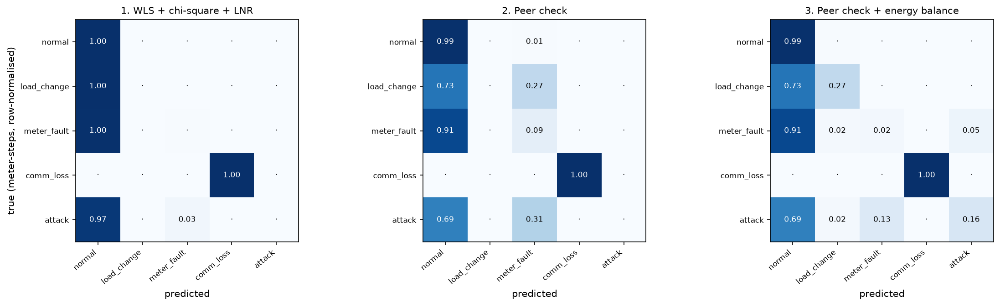
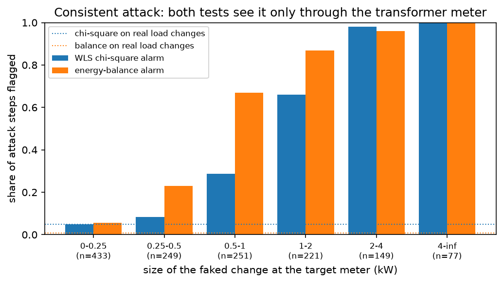

# meter-trust

**Can the operator trust this meter reading?**

When a smart meter suddenly shows less energy, four very different things could be going on:

- the customer really is using less (a **real load change**),
- the meter is broken (a **meter fault**),
- the data stopped arriving or is old (a **communication loss**),
- someone changed the numbers on purpose (a **false-data attack**).

On a utility dashboard these can look exactly the same. This project builds all four, plus normal operation, in a simulated distribution grid and tests how well three common checks can tell them apart.

> This is a simulation on a public test grid (SimBench), not real utility data.

## Why this project

I worked for four years on smart-metering systems in Nigeria. Two problems kept coming up:

1. A meter that undercounted and a customer whose usage really dropped looked the same. Comparing the meter with its neighbours flagged both as "faulty".
2. When the gateway (the data concentrator) for a building went down, every meter behind it went silent at once. Comparing a meter with its neighbours stopped working, because the neighbours were silent too.

This project rebuilds both situations and adds a third: an attacker who edits readings so that they still look physically correct.

## How it works

1. **Grid.** A SimBench low-voltage feeder (`1-LV-semiurb4--0-sw`): one 0.4 MVA transformer, 44 buses, 41 customers, one small PV unit. The customers are split into 3 **gateways**, one per cable leaving the transformer.
2. **Load.** Four weeks of 15-minute load profiles (2,688 time steps). SimBench reuses 10 profiles for 41 customers, so each customer also gets its own random variation (about 30 %). Without it, neighbours would be exact copies of each other and the peer check would look far too good.
3. **Power flow.** An AC power flow (pandapower) for every time step gives the "true" state of the grid.
4. **Meters.** Readings are the true values plus noise:

   | Meter | What it reads | Error (std) |
   |---|---|---|
   | Transformer (trusted) | P, Q, voltage | 0.5 % |
   | Every customer | P, Q | 1.5 % |
   | Last customer on each cable | voltage | 0.5 % |

5. **State estimation.** Weighted least squares (WLS) estimates the grid state from the readings. With clean readings it matches the power flow within the meter noise (notebook 01).
6. **Scenarios.** 300 one-day episodes, 60 per class. Each episode has at most one event, which starts partway through the day.
7. **Detectors.** Three rule-based checks label every meter at every step (below).

## The five situations

| Class | What happens in the simulation |
|---|---|
| Normal | Nothing. Readings are the true values plus noise. |
| Real load change | One customer's demand goes up (1.5-3x) or down (0.2-0.6x). The power flow is re-run, so every reading, the transformer's included, stays consistent. |
| Meter fault | Only the reported value is wrong: reads 0.5-0.8x (gain), freezes (stuck), or slowly drifts down. |
| Communication loss | One meter's readings go missing or repeat the last value (stale), or a whole gateway goes silent. |
| False-data attack | **Naive:** a random offset added to one meter. **Consistent:** the attacker fakes a load change in a copy of the grid, runs a power flow, and writes those values into the target meter and the nearby voltage meter. |

**What the attacker is assumed to know and touch:** the grid model, and the customer meters behind one gateway. The transformer meter is trusted and out of reach.

## The three detectors

All three first mark a reading that did not arrive on time as **communication loss**, as any meter head-end system would.

1. **WLS + chi-square + largest normalised residual (the textbook check).** If the estimate does not fit the readings, raise an alarm and blame the reading that fits worst.
2. **Peer check (what we did in the field).** Predict each customer from the 5 customers it usually tracks. If it drifts away for 2 hours, call it a meter fault.
3. **Peer check + energy balance.** When a meter drifts away from its peers, ask the transformer: does the total still add up?
   - It adds up: the change is real, so call it a **load change**.
   - It does not add up and the meter reads low: **meter fault**.
   - It does not add up and the meter reads high: **attack**.

The peer and balance checks learn only from 21 days of normal history. No labels are used.

## Results

Share of events where the detector gave the right answer at least once (300 episodes):

| Situation | 1. WLS | 2. Peer check | 3. Peer + balance |
|---|---|---|---|
| Communication loss (any kind) | 100 % | 100 % | 100 % |
| Real load change | 0 % (no such answer) | 0 %, called a **fault** in 55-81 % | **55-81 %** |
| Meter fault: stuck | 0 % | 75 % | 30 % |
| Meter fault: gain | 5 % | 30 % | 20 % |
| Meter fault: slow drift | 5 % | 0 % | 0 % |
| Attack: consistent | 0 % | 0 % | **50 %** |
| Attack: naive | 0 % | 0 % | 27 % |

Confusion matrices, detection delays and test-week numbers are in `notebooks/03_results.ipynb`.



### What this means

- **The textbook check can tell that something is wrong, but not where.** The transformer is the only meter that cross-checks the customers, so every customer reading is equally suspect and the residual test cannot single one out.
- **The peer check confuses real changes with broken meters.** This is the field problem from Etrack, reproduced: most real load changes get called meter faults.
- **The energy balance at the transformer fixes most of that.** Asking "does the total still add up?" turns most false fault alarms into correct load-change answers.
- **A consistent attack is visible only through the transformer meter.** Both the residual test and the energy balance catch fakes above about 2 kW and miss fakes below about 0.25 kW. In between, the energy balance is more sensitive and raises fewer false alarms on real load changes.

  

- **If the attacker could also change the transformer reading, nothing here could catch them.** The faked readings would then match a real load change everywhere.
- **A gateway outage also hurts the meters that are still working.** When one gateway fails, about a quarter of the healthy meters lose at least one of their peers. In the worst case more than half do.

## Honest limits

- It is a simulation on one public feeder, with synthetic customer variation. Real data would be messier.
- Each episode has one event lasting to the end of the day. Real faults overlap, come and go, and last weeks.
- The rule that separates attacks from faults uses only the direction of the change. Downward attacks look like undercounting meters and are labelled as faults.
- Slow drift is hard for every detector here.
- The numbers are small: 20-30 events per type, and 7 per attack type in the test weeks.
- An earlier plan expected the residual test to be completely blind to the consistent attack. It is not, because the transformer meter is part of the estimate. The results above are the corrected version.

## How to run

Needs Python 3.11.

```bash
python3.11 -m venv .venv
.venv/bin/pip install -r requirements.txt
.venv/bin/jupyter nbconvert --to notebook --execute --inplace notebooks/01_explore_grid.ipynb
.venv/bin/jupyter nbconvert --to notebook --execute --inplace notebooks/02_scenarios.ipynb
.venv/bin/jupyter nbconvert --to notebook --execute --inplace notebooks/03_results.ipynb
```

Notebook 03 takes about 8 minutes, mostly for the state estimation on all 28,800 steps (run in parallel). The `data/` folder is created by the notebooks and is not stored in git.

## What is in the repo

```
src/
  grid.py           load the feeder, build load profiles, run the power flow
  measurements.py   where the meters are, noise, readings
  estimation.py     WLS state estimation, chi-square and residual tests
  scenarios.py      the 5 situations, labelled dataset
  detectors.py      the 3 detectors
  evaluate.py       confusion matrices, detection delay, figures
notebooks/
  01_explore_grid.ipynb   grid, load profiles, WLS vs power flow
  02_scenarios.ipynb      dataset and one example per situation
  03_results.ipynb        detector results
figures/                  plots used above
```

## Tools

Python, [pandapower](https://www.pandapower.org/) 3.5.6, [SimBench](https://simbench.de/) 1.6.3, numpy, pandas, scipy, matplotlib, scikit-learn. Exact versions are in `requirements.txt`.

A note for pandapower users: in version 3.5.6 a few state-estimation helpers (`zero_injection="no_inj_bus"`, `chi2_analysis`, `remove_bad_data`) do not work on this feeder. `src/estimation.py` explains each problem and the workaround.

## Next

A machine-learning classifier (gradient-boosted trees) trained on the first three weeks and tested on the fourth, to see whether combining all these signals separates the classes better than the rules do.
